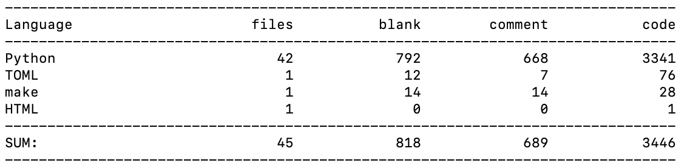
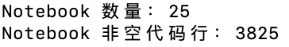
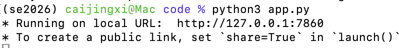
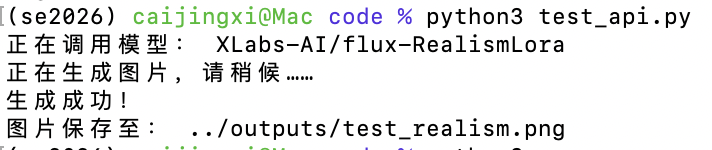
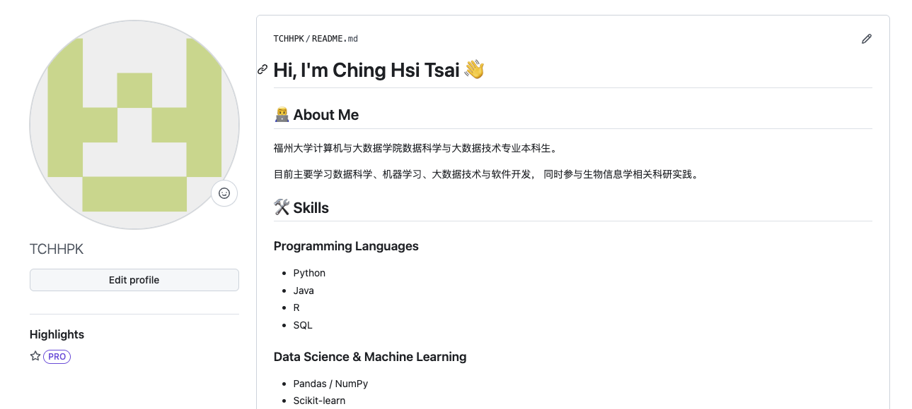

# 2026秋软件工程个人作业（第一次）

| 这个作业属于哪个课程 | [2026-01软件工程与软件工程实践](https://edu.cnblogs.com/campus/fzu/2026-01SoftwareEngineeringandSoftwareEngineeringPractice)     |
| -------------------- | -------------------------------------------------------------------------------------------------------------------------------- |
| 这个作业要求在哪里   | [第一次个人作业](https://edu.cnblogs.com/campus/fzu/2026-01SoftwareEngineeringandSoftwareEngineeringPractice/homework/16716)     |
| 这个作业的目标       | 完成 Hugging Face API 调用与交互式图像生成实践，建设 GitHub 个人主页，梳理自身技术能力与不足，并明确本学期软件工程课程的学习目标 |
| 学号                 | 102042116                                                                                                                        |

## 一、我的技能树与自我评估

目前我的学习方向主要集中在数据科学、机器学习和数据分析。相比单纯列举使用过的工具，我更希望从“能够独立完成什么”和“目前还不会什么”两个角度评价自己的能力。

### 1. 编程与数据处理

**Python：较熟悉**

目前是我使用最多的编程语言，能够使用 Python 独立完成数据读取、清洗、分析、模型训练和结果评估等任务，也能够使用 Conda 管理不同项目的运行环境。

常用工具包括：

- NumPy
- Pandas
- Matplotlib
- Scikit-learn
- Jupyter Notebook

目前的不足是代码更多以课程实验和数据分析为主，对大型 Python 项目的目录设计、模块化、测试、异常处理以及工程规范掌握得还不够系统。

### 2. 机器学习

已经学习并实践过：

- KNN
- K-Means
- PCA
- LDA
- 线性回归
- 随机森林
- 基础模型评估方法

能够完成从数据预处理、模型训练到结果评价的基本流程，但目前对算法底层原理、模型调优以及完整机器学习工程流程的掌握仍需要加强。

### 3. 大数据技术

目前接触过 Hadoop、Spark、Hive 等技术，并进行了相关课程实践。

现阶段更多处于“能够根据任务配置环境并完成实验”的阶段，对于分布式系统原理、性能优化以及真正的大规模生产环境还缺乏实践经验。

### 4. Git 与开发工具

能够使用 Git 和 GitHub 完成：

- 创建和管理仓库
- add / commit / push
- 分支的基本操作
- `.gitignore` 配置
- GitHub 项目的基本维护

但目前的 Git 使用仍以个人项目为主，对于 Pull Request、Issue、Code Review、多人协作和复杂分支管理的实践较少。

### 5. 科研与数据分析实践

目前接触过生物信息学和单细胞数据分析，并使用过 R、Seurat、DESeq2、edgeR、limma 等工具。

这一部分让我开始接触计算机技术在其他学科中的实际应用，但目前仍处于学习和实践阶段，对生物信息学理论以及完整分析流程还需要继续积累。

### 6. Web 与软件工程

这是目前相对明显的短板。

此前的学习更多集中于算法、数据和实验代码，对以下内容缺乏系统实践：

- 软件需求分析
- 软件架构与设计
- 前后端开发
- API 设计
- 软件测试
- CI/CD
- 团队协作开发
- 项目部署与维护

本次作业中使用 Hugging Face API 和 Gradio 制作交互页面，也是我开始接触“将模型能力封装成可以实际使用的软件”的一次实践。

### 7. 技术兴趣

目前比较感兴趣的方向包括：

1. 数据科学与机器学习
2. 人工智能与大语言模型
3. 生物信息学与计算机交叉应用
4. 大数据分析

相比只实现一个能够运行的算法，我希望进一步学习如何把算法、模型和数据分析能力组织成结构完整、可以维护和实际使用的软件系统。

## 二、当前代码量与本学期目标

截至目前，我累计编写的代码量约为 **7,300 行**。

其中，通过 `cloc` 统计得到普通源代码 3,446 行；另外统计了 25 个 Jupyter Notebook，其中包含约 3,825 行非空代码。由于目前的课程学习和实践主要集中在数据科学、机器学习和数据分析，因此 Python 是现阶段使用最多的语言。

本学期结束时，我希望累计代码量能够达到 **15,000 行以上**。

不过相比单纯增加代码行数，我更希望增加的是完整项目中的有效代码量，并逐渐养成模块化设计、版本管理、测试、文档编写等软件工程习惯。




## 四、Hugging Face API 调用与前端实现

### 1. 实验目标

本次实验按照作业要求，使用 Hugging Face 提供的模型服务调用
`XLabs-AI/flux-RealismLora`，并在 API 调用代码的基础上使用 Gradio
制作简单的交互式前端，使用户能够输入 Prompt 并生成对应图像。

### 2. 环境配置

本次实验使用 Python 3.12，并创建独立的 Conda 环境：

```bash
conda create -n se2026 python=3.12 -y
conda activate se2026
```

主要使用的 Python 库包括：

- huggingface_hub
- gradio
- python-dotenv
- Pillow

为了避免 Hugging Face Token 被直接写入代码或上传到 GitHub，
我将 Token 保存到 .env 文件中，并通过 .gitignore 排除该文件。

项目主要结构如下：
第01次作业/
├── code/
│ ├── .env
│ ├── .gitignore
│ ├── app.py
│ ├── requirements.txt
│ └── test_api.py
├── outputs/
├── screenshots/
└── 第一次作业.md


### 3. API 调用

首先使用 huggingface_hub 提供的 InferenceClient 创建客户端，
并指定本次作业要求使用的模型：

```python
MODEL_ID = "XLabs-AI/flux-RealismLora"

client = InferenceClient(
    provider="auto",
    api_key=token,
)

image = client.text_to_image(
    prompt=prompt,
    model=MODEL_ID,
)
```

为了避免将 API Token 直接写入源代码，程序通过环境变量读取 Token：

```python
load_dotenv()
token = os.getenv("HF_TOKEN")
```




### 4. 调用过程中遇到的问题

在第一次通过 Hugging Face Inference Providers 调用模型时，
程序返回了 HTTP 402 Payment Required。
根据错误信息进行排查后发现，请求实际上已经成功发送到
Hugging Face，并被路由至对应的 Inference Provider，
但当时账户可使用的推理额度不足。
这次问题也让我认识到，调用在线大模型 API 时，除了代码本身之外，
还需要考虑 API 权限、服务提供商、调用额度以及计费方式等因素。

### 5. Gradio 交互页面

完成基本 API 调用后，我使用 Gradio 为图像生成程序增加了一个简单的
Web 交互界面。

页面主要包含：

- Prompt 输入框
- 图像生成按钮
- 图像输出区域

用户输入图像描述后点击“生成图片”，前端会调用 Python 中的
`generate_image()` 函数，再通过 Hugging Face API 请求模型完成生成。

核心交互代码如下：

### 6. Prompt 设计与修改过程

> 此部分忘记截屏，次数额度已用完，故没照片

为了使最终图像更加接近真实世界，我没有只进行一次生成，而是逐步增加
场景、光线、摄影方式和真实感方面的约束，并比较不同 Prompt 的生成效果。

#### 第一版prompt

A realistic street in Seoul after rain, people walking on the street, photorealistic.

##### 设计思路

第一版仅描述地点、天气、人物和写实风格，用于观察模型在较少约束下
对场景的自主生成效果。

#### 第二版prompt

A realistic street photograph in Seoul after rain,
pedestrians walking naturally on the sidewalk,
Korean storefronts and street signs in the background,
wet pavement reflecting warm storefront lights,
soft cloudy daylight,
natural colors,
35mm documentary photography,
photorealistic

##### 修改思路

在第一版基础上增加韩国街景、湿润路面、光线、色彩以及 35mm
纪实摄影等信息，希望加强地点特征并使画面更接近真实摄影。

#### 第三版prompt

A highly realistic documentary street photograph in Seoul after rain,
ordinary pedestrians naturally walking along a busy sidewalk,
modern Korean storefronts and Hangul signs in the background,
subtle reflections on wet asphalt,
natural skin texture and realistic human proportions,
slightly imperfect everyday composition,
soft overcast afternoon light,
realistic shadows,
natural and restrained colors,
shot on a full-frame camera with a 35mm lens,
shallow depth of field,
authentic candid photography,
highly detailed,
photorealistic

##### 修改思路

进一步增加自然皮肤纹理、真实人体比例、日常构图、自然色彩和抓拍摄影
等约束，减少过度理想化和明显的 AI 艺术风格。

## 五、GitHub 个人主页

本次作业同时对我的 GitHub 个人主页进行了完善。
个人主页主要包括：

- 个人介绍
- 技术栈
- 项目与实践经历
- 自我能力评估
- 感兴趣的技术方向
- 未来三年的发展规划
  

## 六、API 调用与本次作业总结

本次作业是我第一次比较完整地将 API 调用、模型推理和简单 Web 前端结合起来。
与过去在 Notebook 中完成一个算法实验相比，这次实践让我意识到，将模型真正包装成一个可以交互使用的程序，还需要处理环境管理、API Token、异常、服务额度、前端交互以及项目文件组织等问题。
其中 Hugging Face API 调用过程中遇到的 402 错误也让我实际经历了一次问题定位过程。程序出现错误并不一定意味着代码逻辑错误，还可能来自权限、额度或外部服务。
目前我在软件工程方面仍缺乏完整项目和团队开发经验。希望通过本学期后续作业和团队项目，逐步把已有的编程和数据分析能力转化为更加规范的软件开发能力。
